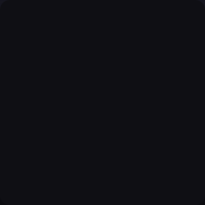

<p align="center"></p>

# Vectro

Free, open-source interactive vector animation: layers, vectors, timelines and state
machines, for every platform. Vectro exports `.riv` files, so what you make plays on the
existing free runtimes for web, Flutter, iOS and Android.

Not affiliated with Rive. "Rive" is their trademark; Vectro reads and writes the format
they publish.

## Status

Early, but it works end to end. Draw rectangles and ellipses or import SVG paths, key position, size,
rotation, scale, opacity, corner radius and colour on a timeline with easing, play it
back, and export `.riv`. Rive's own web runtime plays the export the same way the editor
shows it (checked frame by frame). State machines work in the core (`vectro-doc`): inputs, layers, states, number-driven blends,
transitions with exit times and random choice, pointer listeners and events. Two files prove it in
Rive's runtime: a loading bar and a tiny whack-a-mole game, drawn with gradients, strokes and
Rive's feather (soft shadows and glows). Strokes can draw on: a trim path with keyable start, end
and offset (`examples/draw_on.rs`), shown on the canvas as a dash and trimmed exactly by the
runtime. The editor has a **State machines** tab: inputs, layers,
a node graph (drag a state's port onto another state to add a transition), conditions, exit times,
blends, random weights, and pointer listeners on shapes. **Preview** plays a machine with Rive's own
runtime and gives every input a control.

```
cargo run --release -p vectro-doc --example loading_bar -- tests/web/loading-bar.riv
cargo run --release -p vectro-doc --example whack -- tests/web/whack.riv
# then serve tests/web and open interactive.html?file=whack.riv&sm=Game
```

## Run the editor

```
cd editor
npm install
npm run wasm   # builds the Rust core for the browser (needs wasm-pack)
npm run dev    # http://127.0.0.1:5173
```

Tools: V select, R rectangle, E ellipse, P pen, N edit points (or double-click a path). Shift-click or
drag a box to select several; ⌘G group, ⇧⌘G ungroup, ⌘D duplicate, arrows nudge (shift for 10),
⌘A select all. Pen: click for corners, drag for curves, click the first point to close, Enter or
double-click to finish. Points: drag points and handles, Alt-drag a point to pull handles out, Alt on a
handle breaks the pair, double-click the outline to add a point, ⌫ removes one. View: ⌘-wheel or
pinch zooms, wheel pans, space-drag pans, ⌘0 fits. Space plays, ⌘Z / ⇧⌘Z undo / redo.

## Tools

```
cargo run --release --bin vectro -- import-svg logo.svg > logo.vectro.json
cargo run --release --bin vectro -- export logo.vectro.json logo.riv
cargo run --release --bin riv-dump -- path/to/file.riv
cargo run --release --bin riv-roundtrip -- path/to/*.riv
cargo test
```

## Layout

- `crates/vectro-riv` reads and writes `.riv`; `riv-dump`, `riv-roundtrip`
- `crates/vectro-doc` the document, playback maths and `.riv` export
- `crates/vectro-wasm` the core compiled for the browser
- `editor/` the web editor (Svelte), with a preview that uses Rive's own runtime
- `data/rive-keys.json` type and property table from Rive's MIT runtime
- `docs/format.md` what the format holds, confirmed on real files

MIT licence.

## Brand

`brand/` holds the mark and wordmark as SVG, icon and favicon renders, the GitHub banner, and the
logo animated with Vectro itself (`brand/vectro-logo.vectro.json`, built by `examples/logo.rs`).
`python3 brand/build.py` regenerates the renders. The wordmark is Inter Tight (OFL, in `brand/fonts`).
